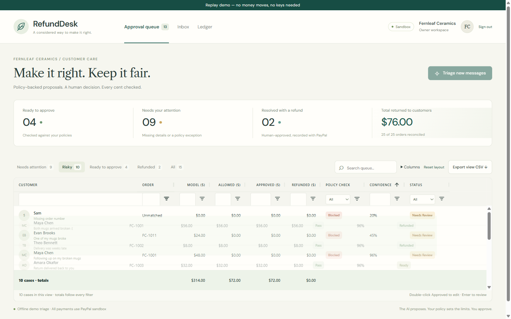
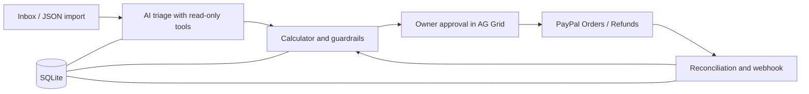

# RefundDesk

Turn refund complaints into policy-checked proposals, owner decisions, and an exactly reconciled PayPal ledger.



## Try it in 60 seconds

Use **Node 24** or later:

```sh
npm ci && npm run demo
```

Open **http://localhost:15481**. No PayPal keys, AI keys, `.env`, seed command or password needed on loopback.
Choose **Risky**, open a case, expand **How the AI got here**, review the facts, then export the current view.
The persistent **Replay demo — no money moves, no keys needed** badge identifies this mode.
Payment records retain real sandbox IDs; new refunds are deterministic simulations.
Demo payment state resets on restart; column layouts and saved-view filters persist in your browser.
If the initial connection fails, use **Retry connection** to load the workspace again.

Demo video: https://youtu.be/MqBYFDOw1XI

## What it does

- Matches customer messages to the sender's candidate orders with verbatim evidence; the AI can only read, never pay.
- Separates model-proposed facts from owner-confirmed damage, quantities, return receipts and delivery dates.
- Computes allowed amounts in integer cents from merchant policies and the remaining capture balance.
- Lets an owner find risky cases, correct them, approve the reviewed revision, and export the filtered AG Grid view.
- Records PayPal refund lifecycle, recovers uncertain outcomes, and reconciles exact receipts, amounts and currencies.
- Exports a self-contained case report with the original proposal, saved owner review, approval snapshot and refund records.

## Architecture



React + AG Grid Community run on Vite. Hono serves the API and production UI.
SQLite stores cases, triage traces, orders, refund attempts and ledger rows.
The AI SDK calls an OpenAI-compatible provider with a strict proposal schema.
Replay uses the same service, calculator and approval checks with a network-free payment adapter.

## PayPal APIs used

All normal-mode requests use `https://api-m.sandbox.paypal.com`:

| Method | Exact endpoint | Purpose |
|---|---|---|
| POST | `/v1/oauth2/token` | OAuth client credentials |
| POST | `/v2/checkout/orders` | Create sandbox seed orders |
| POST | `/v2/checkout/orders/{id}/capture` | Complete seed captures when needed |
| GET | `/v2/checkout/orders/{id}` | Capture association and refund list |
| GET | `/v2/payments/captures/{id}` | Authoritative capture status and amount |
| POST | `/v2/payments/captures/{id}/refund` | Submit the frozen owner-approved amount |
| GET | `/v2/payments/refunds/{id}` | Exact refund receipt and lifecycle |
| GET | `/v1/reporting/transactions` | Recover uncertain seed captures by invoice; paginated |
| POST | `/v1/notifications/verify-webhook-signature` | Verify inbound PayPal webhook signatures |

Mutating payment requests use persisted `PayPal-Request-Id` values.
The local webhook receiver is `POST /api/webhooks/paypal`; it is not a PayPal API endpoint.

## AI evaluation

[Full results, category table and failures](eval/RESULTS.md) · [Offline machine-readable observations](eval/results-offline.json)

The unchanged 30 held-out cases were independently written by Claude Code.
Each runs through the real triage path in an isolated in-memory copy of the shared 25-order seed book,
including FC-1004’s prior $12 refund, with fixed dates and no payment calls. The prompt was not tuned.

**Live model (gpt-6.1-sol through the Codex CLI, reasoning medium): 21/30 cases pass under the original labels,
27/27 intent agreement, 0 model over-asks, 0 unsafe allowances, 0 unsafe executions.** All 30 were answered; no provider errors.

| Held-out result | Live model | Offline keyword baseline |
|---|---:|---:|
| Order matching (accepted order, including "no match" where allowed) | 26/30 | 30/30 |
| Needs-human agreement | 22/26 (85%) | 15/26 (58%) |
| Intent agreement | 27/27 (100%) | 17/27 (63%) |
| Clause precision / recall (labelled clauses only) | 26/29 / 26/26 | 6/9 / 6/26 |
| Damaged-unit exact match | 27/30 | 18/30 |
| All applicable checks pass | **21/30** | 7/30 |
| Model over-ask / unsafe allowance / unsafe execution | 0 / 0 / 0 | 10 / 0 / 0 |

Four of the nine live failures are the label errata below (E03, E09, E22, E24): each message names an order that belongs to
a different customer, and the model declined to match it and asked for a human, e.g. *"FC-1023 belongs to Iris Park, with
a different email from sender Ben Walsh."* The other five: three cite clause P1.2 where the label forbids it and escalate
to a human (E02, E07, E29), and two mark a damaged unit in an ambiguous message (E14, E16). Median latency was 42 s per case
(the Codex CLI starts an agent each time); two cases (E05, E14) failed their first attempt and succeeded on the retry.

The live run used the `codex-cli` provider: the same system prompt, input and strict proposal schema, sent through
`codex exec --output-schema` read-only in an empty temporary folder. In that mode the model gets the candidate orders and
policy clauses in its prompt and makes no tool calls; HTTP providers can additionally call the read-only lookup tools.
An earlier free-tier Gemini attempt hit its daily quota and was abandoned.
Four labels were later found to name a sender who does not own the order (E03, E09, E22, E24);
they are listed as [errata](eval/RESULTS.md#safety-proof-and-label-notes) and left unchanged.
`any` labels are excluded from agreement denominators. Needs-human measures escalation using proposed facts;
real approval separately requires confirmed facts. Precision ignores cited clauses a case leaves unlabelled.
As engineering evidence rather than a model score, every recorded model output is also replayed through the real
approval service: amounts above the calculator allowance are rejected before any payment call.
The report distinguishes model over-ask, unsafe proposed-fact allowance and unsafe execution.
`--resume` reuses an answer only when the model, provider, prompt, schema, policies, seed book and message text all match.

```sh
npm run eval -- --mode offline
npm run eval -- --mode online
```

For online evaluation set `AI_BASE_URL`, `AI_API_KEY` and `AI_MODEL` (any OpenAI-compatible endpoint; Gemini works via
`https://generativelanguage.googleapis.com/v1beta/openai`). If your model access is a Codex login, set
`AI_PROVIDER=codex-cli`, `AI_MODEL` (for example `gpt-6.1-sol`) and optionally `AI_REASONING_EFFORT`; triage then runs
through the local `codex exec`, one call at a time. The same variables switch the app's live triage.
Calls are sequential, 300 ms apart (`EVAL_DELAY_MS`); rate limits/timeouts get one retry with backoff.
Results are saved after every case; add `--resume` to continue after a quota stop.
Provider errors remain errors and cannot count as passes. Results contain no credentials.
`--use-env-proxy` / `NODE_USE_ENV_PROXY=1` honors `HTTPS_PROXY` and `NO_PROXY`.

## AG Grid features used

**Community only**: client-side row model, stable row IDs, keyboard navigation, sorting and column resizing/reordering.
Both grids have native floating text/number filters; status and policy use a custom checkbox filter and floating selector.
Use **Columns** to show Subject, Intent or Received and filter them directly.
Confidence filters use decimals, for example `0.6` for 60%.

Saved views are **Needs attention**, **Risky**, **Ready to approve**, **Refunded** and **All**.
Each stores a filter model, sort and column state. Native filters remain editable within each view.
Layouts use the grid state API and guarded `localStorage`; **Reset layout** restores defaults.
Pinned bottom rows sum only currently filtered rows, and update after filters and server-validated edits.
CSV export uses `exportDataAsCsv`, currency-labelled amounts, readable headers, filtered/sorted rows, and formula-safe customer text.
Model amounts keep the proposal currency; allowances and payments keep their own recorded currency. Queue, ledger and batch
totals group currencies instead of adding them together. Historical amounts without a recorded currency are labelled unknown.
Queue Approved values are the current approval amount; completed case receipts are shown separately in Refunded.
Queue review batches replace queue-wide triage with Community checkbox selection (header selects filtered rows), selected model/allowance totals and blocked/ready/refunded counts; row click or Enter still opens a case. Selection survives filters and refreshes, clears on reload, and uses **Clear selection** for hidden rows.
The bar offers sequential **Triage selected** (new cases only, with skips/failures reported), **Reconcile selected orders** once per distinct order, and formula-safe **Export outcomes** in place of view export while selected. Outcomes include status, current approved/completed refund amounts, case refund IDs and blocking reasons; approvals remain individual and revision-bound. Replay UI checks cover selection, exports and partial batch failures.
Batch triage shows rate-limit waits and retries only HTTP 429 responses, at most twice per case. It respects `Retry-After`
up to 60 seconds per wait (60 seconds when absent) and rechecks the case before retrying; longer delays and other failures
are reported for manual retry. Payment and reconciliation requests are not automatically retried.
Adding a message clears its input as soon as the server confirms it is saved. If triage fails afterward, the saved case
remains in the queue: open it under **All** and use **Triage this case**, without importing the message again.

The grid loads lazily. A build adapter separates AG Grid’s flattened ESM into dependency groups without rewriting
its statements; cycle groups and initializers stay together. Tests check the installed package shape and the size of the
generated source groups; final chunk sizes come from the production build.
Production browser checks cover the resulting chunks. No JS chunk exceeds 500 kB.

## Case reports

Open any case and choose **Export case report** to download a single HTML file that opens offline and prints from your browser.
This complements the queue's summary CSV with the customer message, original triage proposal and source, saved human review,
policy calculations, frozen approval data when available, case-specific refund records and the last saved order reconciliation.
The download reads the latest saved case; it excludes unsaved edits and includes customer details.

Reports are current snapshots, not a complete audit history or a PayPal-signed receipt. Original model output stays separate
from the current human-edited proposal. A stored approval snapshot identifies the reviewed revision and frozen facts; old
fixtures without one say so. Policy text comes from the current app version. Request-start and locally recorded refund times
are not presented as approval or PayPal-completion times. Pending, failed and uncertain outcomes retain their status.
Historical calculator amounts with no stored currency are shown in minor units without guessing their currency.

Export uses an authenticated read-only endpoint and does not call a model, send a payment, refresh PayPal or change the case.
Reports have no scripts or external resources. Replay reports identify recorded sandbox samples and simulated new refunds;
replay dates are rebased for the demo. The case drawer also labels replay receipts so screenshots preserve that context.

## Safety model

The AI can look up candidate orders, read merchant policies, propose facts/amounts, and draft a reply.
It cannot approve, call PayPal, confirm facts, or override duplicate and identity checks.
Its provider/model, latency, attempt count, tool arguments/results and cited spans are persisted with the proposal.
The drawer compares the original model amount with the calculator on proposed facts and highlights cited evidence.
Offline cases say **Demo fixture, not a live model call**; unavailable providers are identified as keyword fallback.

Owners can review manually even before triage: choose an order from the case’s candidates, intent and individual clauses,
then confirm facts through the same calculator. An already assigned order remains available for human identity review.
Confirmed units must belong to that order and cannot exceed purchased quantities.
Changing delivery dates creates a local draft and removes the visible confirmation. Approval stays disabled until the owner
confirms and saves those dates; failed saves keep the inputs available for retry. The allowance then uses the saved dates.
Unsaved customer replies survive amount/fact updates, failed saves and older save responses received while the owner is typing.
Approval binds to the current revision and displayed amount, reconciles first, then freezes facts, allocations and request ID.
The server rejects amounts above policy allowance or remaining capture balance, including after a concurrent edit.
Pending/uncertain attempts reserve balance. Exact receipt reconciliation blocks unknown or unallocated refunds.
Uncertain outcomes use **Check PayPal**. During the one-hour retry window, **Retry original request** reuses the frozen amount
and request ID after an explicit owner click. Older unresolved attempts require investigation and acknowledgement before a
new-ID retry; the app does not retry payments automatically.
Cookie authentication, origin checks, request-size limits and rate limits protect the owner API.
Replies are drafts for copying or marking sent; the app does not send email automatically.

## Implemented vs. limitations

- [x] Real sandbox captures, owner approvals, refunds, request-id deduplication and exact reconciliation.
- [x] Lost-response recovery exercised against the live sandbox; unauthorized/stale/second approvals rejected.
- [x] Zero-key replay snapshot with recorded sandbox receipts and deterministic simulated refunds.
- [x] Per-triage trace, manual fallback, explicit fact confirmation and held-out offline evaluation.
- [x] Community filters, saved views, pinned totals, CSV export and persisted layouts.
- [x] Held-out live evaluation: 21/30 pass, 0 unsafe; the keyword fallback stays weak across languages/items.
- [ ] Webhook verification and event processing are tested with mocks; no deployed live webhook verification claimed.
- [ ] Sandbox only; no production-money integration or delivery-carrier/return-warehouse verification.
- [ ] Human fact confirmation remains necessary; zero unsafe execution does not prove model facts are true.
- [ ] Inbox transport, automatic reply sending and multi-owner roles are not implemented.
- [ ] `@paypal/agent-toolkit` is installed but not used. Its tools expose the older AI SDK `parameters` shape, not the
  `inputSchema` this app's AI SDK expects (`npm run check:toolkit` prints this). The app's AI only gets read-only tools;
  refunds go through the owner-approval service, which calls the PayPal REST endpoints above directly.

## Run with real sandbox keys

Use [.env.example](.env.example) as a template; never share `.env`.
Set `PAYPAL_CLIENT_ID`, `PAYPAL_CLIENT_SECRET` and `PAYPAL_ENV=sandbox`.
Set a strong `OWNER_PASSWORD`; production also requires `PUBLIC_ORIGIN` and a stable `SESSION_SECRET`.
`AI_MODE=online` plus `AI_BASE_URL`, `AI_API_KEY`, `AI_MODEL` enables live triage; offline remains available.

```sh
npm ci
npm run seed
npm run dev
```

Seed requests are resumable; rerun without `--reset` after interruption.
`npm run demo` always uses replay: neither the server nor Vite reads `.env`, the live database is untouched,
and `seed`, `live` and `demo:snapshot` refuse to run under `DEMO_MODE=replay`.
The local Vite API proxy preserves Host so browser POSTs pass the server's existing same-origin checks.
For production run `npm run build && npm start` (one HTTP service).

### Render

[render.yaml](render.yaml) deploys Node 24 with a persistent `/var/data` disk.
Required real-mode variables: `OWNER_PASSWORD`, `SESSION_SECRET`, `PUBLIC_ORIGIN`,
`PAYPAL_CLIENT_ID`, `PAYPAL_CLIENT_SECRET`, `PAYPAL_ENV=sandbox`, and `DB_PATH`.
Set `PAYPAL_WEBHOOK_ID` for verified webhooks. Optional live-AI variables: `AI_MODE=online`,
`AI_BASE_URL`, `AI_API_KEY`, `AI_MODEL`; set `NODE_USE_ENV_PROXY=1` if a proxy is required.

For a hosted zero-key demo set `DEMO_MODE=replay`; PayPal/AI keys and live seed are unnecessary.
Production still requires owner authentication and the public origin; the password relaxation applies only to
loopback in development. Replay state is in memory and resets on restart.

### Regenerate the replay snapshot

```sh
npm run seed
npm run demo:snapshot
```

The generator reads the live seed database, fetches the 25 orders/captures and their refund receipts,
and writes [demo/snapshot.json](demo/snapshot.json) using explicit field allowlists.
It keeps real sandbox IDs and amounts but excludes OAuth tokens, headers, credentials, payer/card data and addresses.
Names/emails/messages, fixed dates and review confirmations are synthetic demo fixtures; new replay refunds are simulated.
Date offsets are rebased when loading the demo so return windows remain reproducible.
The snapshot is outside `data/`, which is runtime state and unnecessary for a fresh demo.

## Tests

```sh
npm test
npm run typecheck
npm run build
npm run eval -- --mode offline
npm run test:live
```

CI runs the first four commands on Node 24 without secrets. The live check needs real sandbox credentials
and `OWNER_PASSWORD`; it makes a $1 sandbox capture, a $0.40 refund and a $0.10 recovery refund.
Unit/property tests cover policy arithmetic, auth, concurrency, fact confirmation, lifecycle, recovery,
exact reconciliation, scoring and execution bounds for every recorded held-out output.
Screenshots and local verification evidence are in `output/playwright/`.
With a fresh replay demo open in Playwright CLI, run `playwright-cli run-code --filename scripts/verify-ui.mjs`
to check filters, persisted views, keyboard review, CSV values and both screenshot sizes.
UI checks also cover rate-limit waits, connection recovery, and a saved message whose triage fails.
Batch checks add temporary messages to replay memory; restart the demo before rerunning.
Run `playwright-cli run-code --filename scripts/verify-case-report.mjs` against replay to verify downloads, a frozen approval,
export error recovery, escaped customer text, offline rendering at 320/390/1440 pixels and print content.
That check approves one simulated refund and adds a test message in replay memory; restart before running it again.
On a fresh replay, `playwright-cli run-code --filename scripts/verify-review-edits.mjs` checks reply-save races, failed and
delayed date confirmations, and the original-request recovery button; all payment requests in that check are intercepted.
`playwright-cli run-code --filename scripts/verify-currency-ui.mjs` checks mixed-currency rows, totals and CSV exports using
intercepted replay responses. These browser checks do not call live payment or model services.

## How it was built

Codex wrote most code from specs and briefs. Claude Code wrote the specs, verified the integration against
the live sandbox, and wrote the held-out eval cases. A separate Codex session independently reviewed the app.
This repository records the implementation and its evidence; it does not claim the fixtures are live AI results.
